# Ancilla

[](LICENSE)
[](https://github.com/aleff-ferreira/ancilla/releases/latest)
[](https://github.com/aleff-ferreira/ancilla/releases/latest)

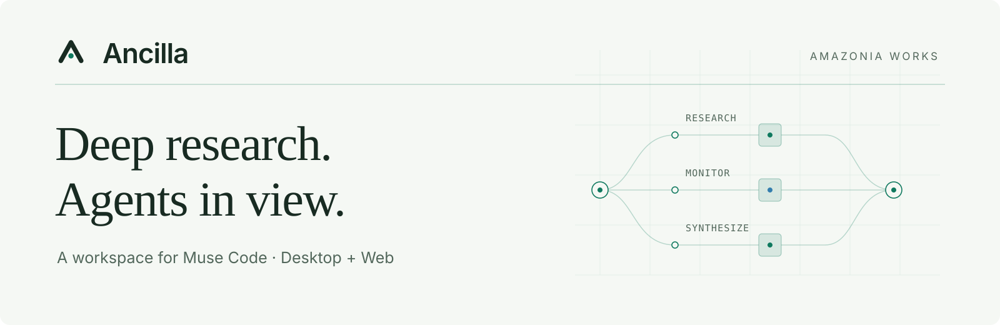

**Deep research, agent monitoring and approvals across your AI subscriptions and local models.**

An open-source desktop and web app (`AGPL-3.0-only`) for Meta's **Muse Code CLI** (`muse`), **OpenAI Codex** (`codex`),
**Anthropic Claude Code** (`claude`), **Google Gemini CLI** (`gemini`), **GitHub Copilot CLI** (`copilot`), **Kimi**,
**Qwen**, **OpenCode**, **Agent Client Protocol (ACP)** agents, and **Direct API / local model servers** (OpenRouter,
Venice, OpenAI, Anthropic, Google Gemini, Ollama, LM Studio, llama.cpp, vLLM) on Windows, macOS and Linux.

**[Download Ancilla](https://github.com/aleff-ferreira/ancilla/releases/latest)** ·
[See it in action](#see-it-in-action) · [Supported subscriptions](#supported-ai-subscriptions-and-providers) ·
[Deep Research](#deep-research) · [Crew monitoring](#crew-agent-monitoring) ·
[Build from source](#build-from-source) · [Changelog](docs/CHANGELOG.md)

> **New in 0.28.1:** independent provider, account, and model selection across Chats / New threads, Assistant tasks, and Voice calls (with per-provider defaults, searchable catalogs, and all five published Muse Code models), plus full OAuth URL preservation, in-modal authorization-code pasting for Claude Code, persistent callback sign-in for Codex, and `~/.local/bin` / `~/.nvm` WSL CLI discovery.
> [Read the release notes](docs/CHANGELOG.md#0281).

> **Unofficial community project.** Ancilla is an independent open-source project and is not made, endorsed, or
> supported by Meta, OpenAI, Anthropic, Google, GitHub, Microsoft, Moonshot AI, Alibaba, OpenRouter, or Venice, and is
> not affiliated with any of them. Product and company names ("Muse", "Muse Code", "ChatGPT", "Codex", "Claude",
> "Gemini", "GitHub Copilot", "Kimi", "Qwen", "OpenRouter", "Venice") are trademarks of their respective owners, used
> here strictly for nominative description of the official CLIs and APIs that Ancilla connects to.

## See it in action

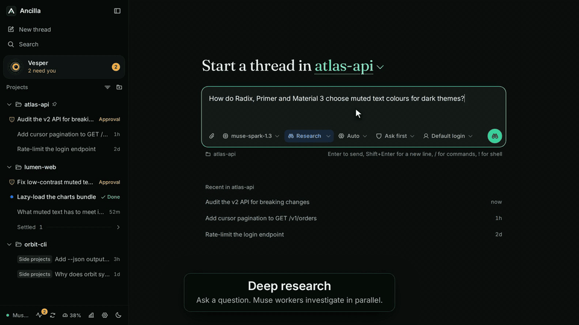

[Download the full tour](https://github.com/aleff-ferreira/ancilla/raw/main/docs/assets/ancilla-tour.mp4) (MP4, 1 min 39 s, no sound, sample data).

## Deep Research

Ask a question, set a research window, and let Muse workers investigate in parallel. Ancilla coordinates the brief,
research rounds and final writer, then puts the report back in the same thread. Model calls, web searches and page
reads run through Muse; no separate model or search API key is needed.

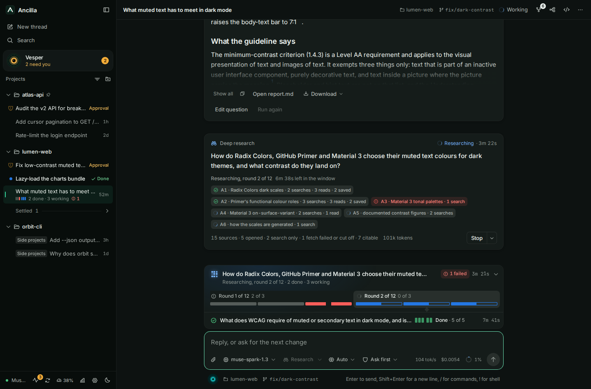

*Screenshots throughout this page use representative demo threads and sample reports, activity and quota values.*

1. **Set the scope.** Switch on **Research** in the composer, type your question, and choose the time window and
   number of parallel workers from **Research options**. `Ctrl/Cmd+Shift+R` toggles research mode.
2. **Follow the work.** See the current phase, worker states, searches, page reads and source counts in the thread
   and Crew panel.
3. **Keep control.** Let the run finish, stop and ask for a report from its findings so far, or stop immediately.
   A partial report is labelled as such.
4. **Read and reuse.** Follow the report's numbered citations, copy its Markdown, open `report.md`, or download
   **PDF, Word or HTML**. Choose a filename and destination in the desktop Save As dialog or a supported browser's
   file picker. Edit the question or run it again with the same options.

### Reports with traceable sources

Ancilla builds the citation registry from URLs observed in the workers' tool calls, deduplicates sources, and turns
registered citations into linked footnotes. A source can be cited when a worker opened the page (a page fetch that
succeeded) or when the URL appeared in a completed search result. A URL that only appeared in a prompt, a shell
command or another tool's text cannot, and neither can a page whose fetch failed unless a search result also listed
it; the run shows how many sources were opened, found in search results only, or had a fetch that failed or was cut
off. A source counts in at most one of those three; a source that no worker call saw is in none of them and cannot be
cited. This checks where a source came from; it does not verify that a source supports a claim, and Ancilla cannot
confirm one. When no source could be cited at all, the run ends as a partial report and says so.

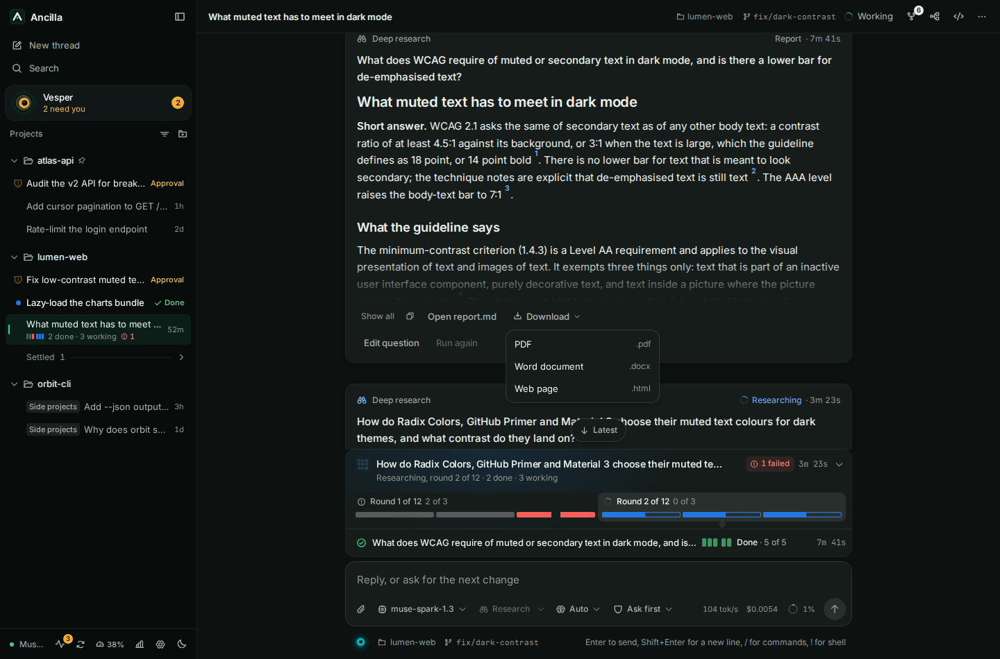

Reports and source registries are saved under `.ancilla/research/<runId>/` in the project. Run history persists across
restarts; **resuming an interrupted research run is not available yet**. You can start it again from its question.
Downloading a document saves an additional copy to your chosen location. Browsers without a save picker use their
download settings; enable **Ask where to save** in that browser to choose a destination for each download.
The [research implementation notes](docs/deep-research-plan.md#12-implementation-notes-what-the-build-changed)
describe the engine, budgets and current limits.

## Crew: agent monitoring

See the work behind ordinary prompts as well as parallel research. Crew follows the lead agent's turns and foreground
tools, Muse workflows, native subagents, Deep Research workers and background shell tasks in the thread's monitoring
surfaces. Research mode is not required.

Each prompt gets a calm card above the composer. It rests shut with one line of what is happening and opens to the plan
and the latest calls; its progress moves only when Muse reports, with no clock-driven estimate.

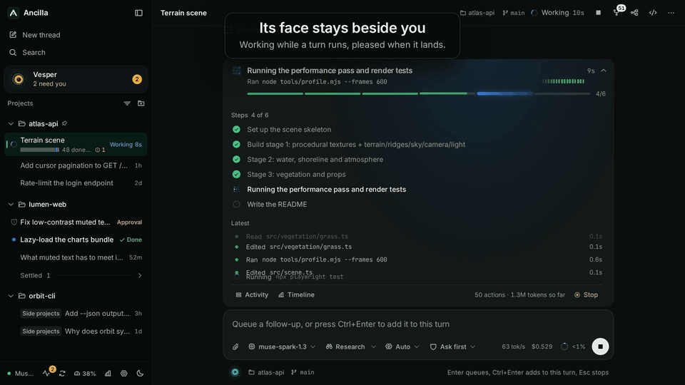

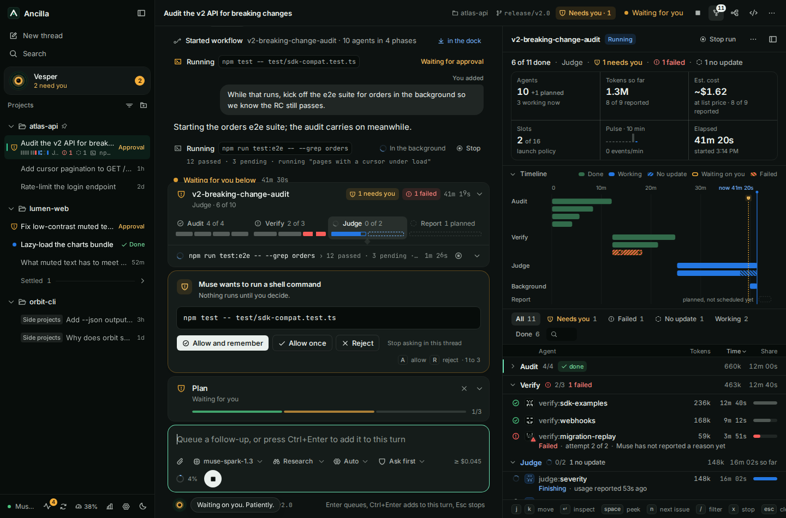

| Surface | What you can follow |
| --- | --- |
| **Crew card** | A compact summary above the composer for the lead turn or a parallel run: current activity, phase, completed agents, pending requests and failures. Expand it for agent rows and controls. |
| **Crew panel** | Lead-agent, workflow and research activity, timelines, phase groups, filters, an agent inspector, recorded lifecycle events, token totals and completion summaries. Open with `Ctrl/Cmd+Shift+M`. |
| **Background tasks** | The command, current state and latest output, with output inspection and task controls. |
| **Activity drawer** | Pending requests across threads, plus lead turns, runs and tasks from threads this window has opened. Open with `Ctrl/Cmd+Shift+A`. |
| **Sidebar** | Small phase and progress indicators alongside each tracked thread, so you can switch context without losing the overview. |

Review approvals, inspect a failure, and retry, skip or stop work where Muse exposes those controls. Research workers
show their search, read and saved-source counts; research runs use their own stop and report controls.

The display stays explicit about what is known. Missing token counts remain unreported, elapsed silence is shown as
**No update** rather than a guessed failure, and a disconnected feed is marked **Last known**. Workflow requests stay
at run level when Muse does not identify the requesting agent. Cost figures are list-price estimates.
See [Agents and tasks](docs/agent-activity.md) for the full interaction model and Muse's reporting limits.

## An assistant that remembers, and works on what you approve

Switch on the **Assistant** page (the brain icon in the sidebar footer) and threads stop starting from nothing. It reads
what you type, keeps rules, preferences, decisions, deadlines and facts with your exact words and where each came from,
and puts the notes that bear on a message in front of the prompt. It adds no model of its own and costs no extra: Muse
still does the thinking, on your plan, unless you choose otherwise for a call. Voice calls and finding notes by meaning
are optional extras that use models you choose, and send nothing anywhere until you set them up. The assistant is **off
until you switch it on**.

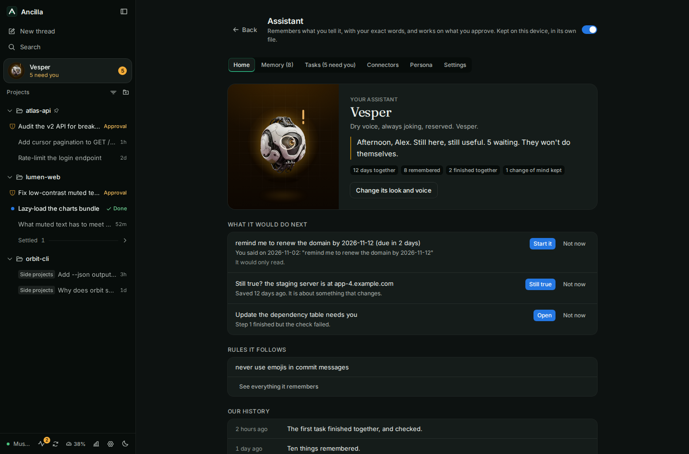

| Capability | What it does |
| --- | --- |
| **Memory you can read** | Every note shows who said it and when, with its earlier versions. Correct it, pin it, confirm it, settle a dispute, export everything, pause remembering, or erase a note, and the same old words are not learned again. |
| **Honest about what it knows** | A guess never replaces what you said, a note that may be out of date says so, and when nothing saved answers a question it says that. Passwords, keys and ID numbers are never kept. |
| **Tasks** | Give it work and it runs through Muse in a thread you can open, one step at a time, inside limits you set. It is marked done only when a check that reads a file passed. A step that may already have changed files is not run again after a restart. |
| **Talk to it** | An optional voice call. It listens while you talk and works out when you have finished, answers a sentence at a time, can be cut off in the middle of a word and goes on from what you heard, remembers the conversation, and starts read-only work in the background while you keep talking. The speech recognition and the voice run on your computer (a download of about 0.6 GB that you start yourself); the model that answers is your choice: your Muse plan, or any server that speaks the common chat protocol, including one on your own machine. English and Brazilian Portuguese. Actions that change files, launch processes, or inspect new sites show an authorization card on the call dock and in Tasks unless pre-authorized (such as YOLO mode), requiring a click on screen or an explicit confirmation on a subsequent turn when microphone echo cancellation is active. [How it works and what was measured](docs/assistant-voice.md). |
| **Finds notes by meaning** | Optional. Name an embedding model (one running on your computer works) and a question that shares no word with a note, such as "which car do I own?" against "drives a Subaru", can still find it. Measured on the evaluation's questions: at least twice as many paraphrases found, for about one point of precision. Nothing is sent anywhere until you name a model, and then only to it. |
| **Initiative, within limits** | Ask first, suggest, or act on its own for work that only reads, a couple of times a day at most. Memory never grants permission: settings and Muse's approvals do. |
| **A character of your own** | A short first meeting, or the Persona tab later, gives it a name, a face, a voice (eight temperaments and five dials) and up to four habits. The face is one of twelve studio-rendered 3D companions or three geometric forms of light, pixel art you draw, or a picture, sprite sheet or desktop-pet `.zip` package you bring, with customizable stage lighting. Its face is in the sidebar, on the Home tab and beside the composer, where it works while a turn runs, wants you when something waits and is pleased when it finishes. It changes how it sounds, never what it may do or what is true, and it says it is an AI if you ask. |
| **What you have shared** | Days together, what it remembers, what you finished together and a few round numbers, read from what is stored. No streaks and nothing that counts the days you were away, and you can hide it. |

See [the assistant](docs/assistant.md) for setup, the API and how to roll back, and
[how it is measured](docs/assistant-evaluation.md) for what it does well and where it is weak.

<details>
<summary>The first meeting, what it remembers and its Persona tab</summary>

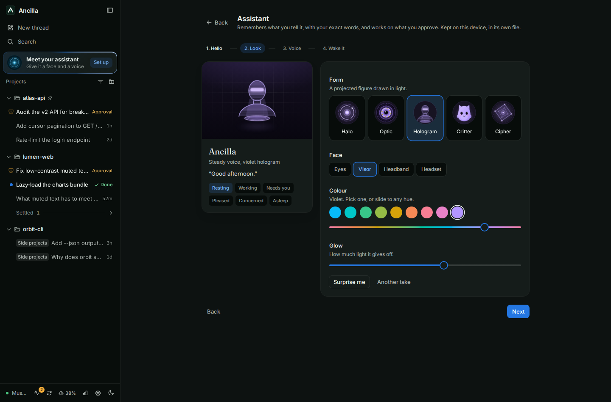

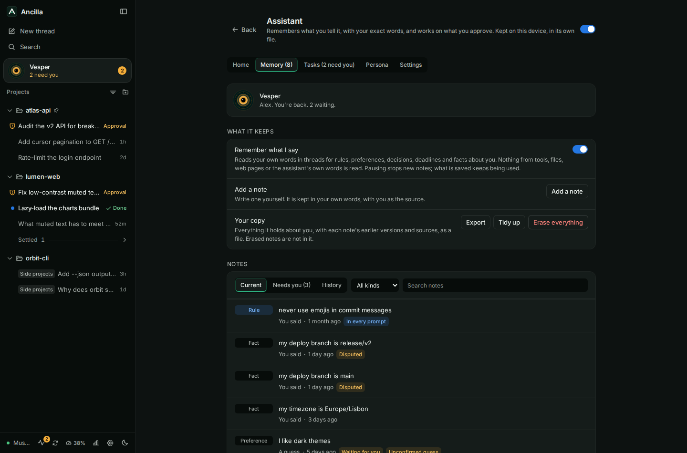

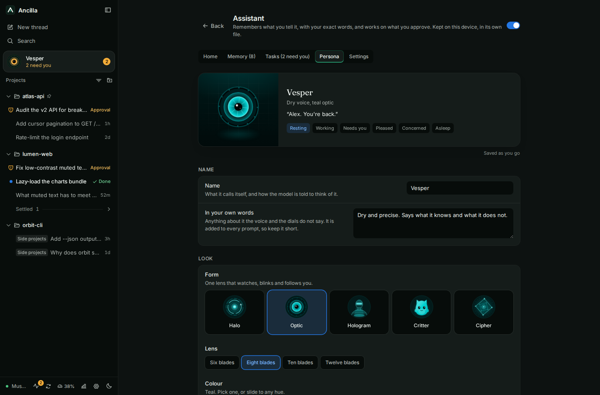

</details>

## Supported AI subscriptions and providers

Configure subscriptions, isolated multi-account profiles, API keys, and local model servers in **Settings → AI subscriptions** (or choose a provider per project from the **Provider & Account** menu beside the model picker):

| Provider | Plans / Billing | Official CLI or Transport |
| --- | --- | --- |
| **Meta Muse Code** (`muse`) | Muse Code subscription | `muse serve` over Muse Session Protocol (MSP) |
| **OpenAI Codex** (`codex`) | ChatGPT Plus, Pro, Team, Edu, Enterprise | `codex app-server --listen stdio://` |
| **Anthropic Claude Code** (`claude`) | Claude Pro, Max, Team, Enterprise | `claude -p --input-format stream-json --output-format stream-json --permission-prompt-tool stdio` |
| **Google Gemini CLI** (`gemini`) | Google AI Pro, AI Ultra, Gemini Code Assist | `gemini --acp` (Agent Client Protocol) |
| **GitHub Copilot CLI** (`copilot`) | Copilot Pro, Pro+, Business, Enterprise | `copilot --acp --stdio` (ACP) |
| **Kimi / Qwen / OpenCode** | Vendor coding subscriptions & plans | `kimi acp`, `qwen --acp`, `opencode acp` (ACP) |
| **Custom ACP Agents** (`acp:*`) | Any ACP-compatible agent binary | User-configured JSON-RPC 2.0 ACP over `stdio` |
| **Direct API & Local** (`api`) | OpenRouter, Venice, OpenAI/Anthropic/Google BYOK, Ollama, LM Studio, llama.cpp, vLLM | Built-in HTTP streaming + approval-gated workspace tools |

- **Official CLI delegation only:** For consumer and team AI subscriptions, Ancilla spawns the unmodified official CLI you installed on your machine (or inside WSL2 on Windows) over `stdio`. Ancilla **never** reads, decrypts, copies, or proxies third-party OAuth tokens or OS keychain entries, and never spoofs first-party OAuth client IDs.
- **Isolated named profiles:** Create separate Work and Personal profiles per CLI (`CODEX_HOME`, `CLAUDE_CONFIG_DIR`, `GEMINI_CLI_HOME`, `COPILOT_HOME`, XDG roots) under `~/.ancilla/provider-profiles/<provider>/<id>/` without mixing credentials.
- **Pay-as-you-go bill protection:** When launching a subscription CLI profile, Ancilla strips inherited ambient API keys (`OPENAI_API_KEY`, `ANTHROPIC_API_KEY`, `GEMINI_API_KEY`, `GOOGLE_API_KEY`, `GITHUB_TOKEN`, `META_API_KEY`, etc.) by default and displays a warning banner in Settings so flat-rate subscription sessions never accidentally bill per-token API keys.

## Subscription usage, alongside local activity

The Usage page shows your **5-hour window and weekly limits**, including used and remaining percentages, reset
times and any reported plan name. With a supported Muse login, **Refresh** runs `muse usage --json` to read your
subscription allowance without starting a persistent `muse serve` host or spending model tokens. Choose the account explicitly; another account's activity
does not switch the meter. The last report is always kept, however old: once it is no longer current it is shown as the
**last report**, with its age, whether its window has ended and how to get a current one, instead of a misleading bar.

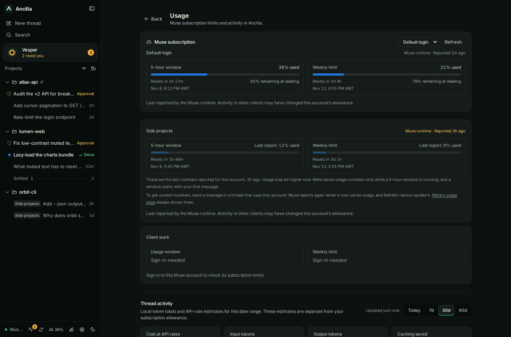

Below the subscription section, explore local token history by date, model and thread. **API-rate cost estimates are
separate from subscription allowance and are not a bill.** Meta sends quota data only while a 5-hour window is running
(it starts with your first message), so an idle account shows its last report. The default
login under WSL is read from the distro's own login file; named accounts under WSL and Keychain-only logins use
labelled runtime observations; saved readings retain their original age. API keys do not
establish subscription allowance. See [subscription data sources](docs/subscription-usage.md) for the precise limits.

## The everyday workspace

| Capability | In Ancilla |
| --- | --- |
| **Projects and threads** | Group folders into projects, pin and archive threads, and discover sessions started from the `muse` terminal. |
| **Conversation control** | Read streamed replies and diffs; approve, steer, stop, queue and resend prompts using Muse's approval modes. |
| **Plans** | Follow the latest reported steps alongside their turn and workers. A plan stays with its prompt, finished or not, until you send the next one; unfinished steps are not marked complete just because a turn ended. |
| **Files beside the work** | Browse the project and preview files without leaving the thread. |
| **Multiple logins** | Choose named Muse accounts and set a default account per project. |
| **Desktop and web** | Use the same interface in a Tauri desktop app or a browser connected to a local or remote server. |

<details>
<summary>Home and coding thread screenshots</summary>

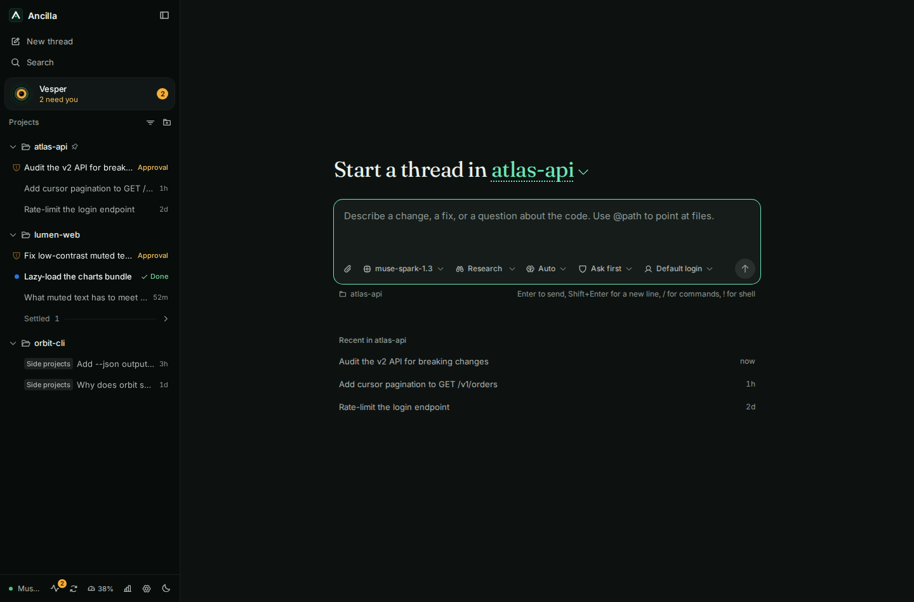

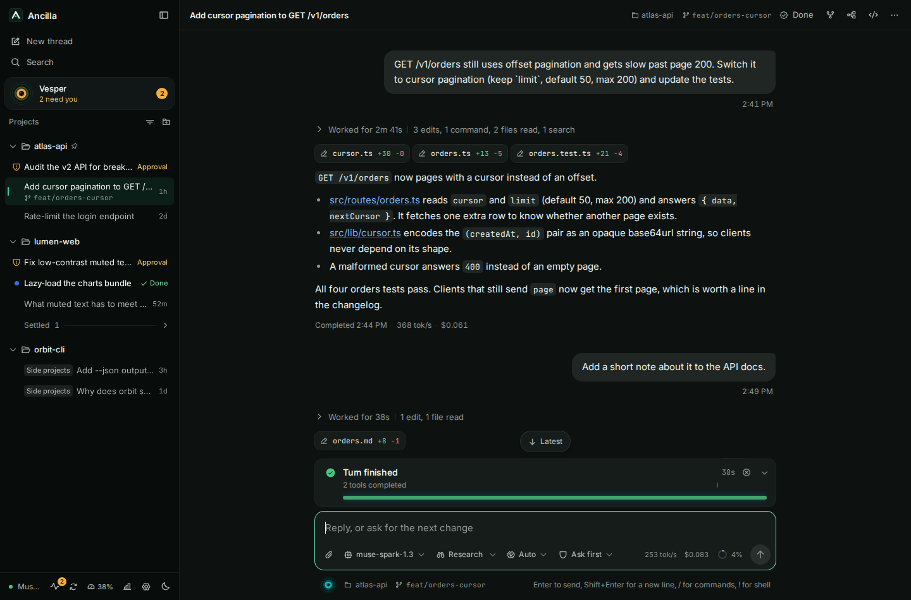

</details>

## Install

Download the installer for your platform from the
[latest release](https://github.com/aleff-ferreira/ancilla/releases/latest). Ancilla bundles its own Node.js, so the
only runtime requirement is the `muse` CLI. Ancilla reuses a login you already have; there is no separate Ancilla account
to create. Connect a new login directly from the app:

1. **Install Muse if needed.** On Linux, choose **Install Muse Code** in Ancilla; the app downloads Meta's installer
   and shows any browser approval it needs. On Windows and macOS, setup shows the command for your selected runtime;
   finish installation, then choose **Check installation**.
2. **Choose Sign in with Meta** on Home or in **Settings → Accounts**. Use the Meta account that owns your Muse Code plan.
3. **Open Meta sign-in**, check or enter the displayed code, and approve access in the browser. Return to Ancilla for
   confirmation; **Check sign-in** checks immediately if needed.
4. **Add a project and start a thread.** Named accounts are optional. Add one in Settings when you want a separate login
   for work, personal projects or a client.

No API key is needed for this subscription flow. If `META_API_KEY` is set, Ancilla explains that it overrides browser
sign-in; remove that variable from Muse's launch environment and restart Ancilla to use your plan. Separately created
API keys use pay-as-you-go billing.

**Windows:** run `Ancilla_<version>_x64-setup.exe`. The installer is not Authenticode-signed yet, so SmartScreen may
warn that it is from an unknown publisher; choose **More info**, then **Run anyway**. Updates after that are
signature-checked by Ancilla's built-in updater before they install.

Install Muse Code for Windows with `irm https://dev.meta.ai/install.ps1 | iex` in PowerShell. Already run Muse inside
WSL2? Ancilla uses it when native Muse is not installed; set `ANCILLA_MUSE_RUNTIME=wsl`, or `"runtime": "wsl"` in
[`runtime.json`](docs/muse-recovery.md#runtime-configuration), to keep WSL when both are.

`ANCILLA_HOST_START_TIMEOUT_MS`, or `"hostStartTimeoutMs"` in `runtime.json`, sets how long a Muse host may take to answer its start before Ancilla gives up on it (whole milliseconds, 0 to 2147483647; the default is `300000`, and `0` turns the limit off; the variable wins over the file, and a value that is not a whole number of milliseconds is ignored with a line in the log).

**macOS:** open `Ancilla_<version>_universal.dmg`; one build runs on Apple Silicon and Intel. The app is not
Apple-notarized yet, so the first launch needs a right-click on the app, then **Open** (on recent macOS, **System
Settings > Privacy & Security > Open Anyway**).

### Linux: install, sign in, choose a folder

Choose the package for your **x86_64** computer:

| Your Linux distribution | Download |
| --- | --- |
| Ubuntu, Debian, Linux Mint and compatible distributions | `Ancilla_<version>_amd64.deb` |
| Fedora and compatible RPM distributions | `Ancilla-<version>-1.x86_64.rpm` |
| Other distributions, or a portable copy | `Ancilla_<version>_amd64.AppImage` |

1. **Open the `.deb` or `.rpm` with your software installer and choose Install.** It installs the dependencies and
   adds Ancilla's icon to the application menu. Open **Ancilla** there; you can pin it to your dock or favorites.
2. **Follow the setup screen.** Choose **Install Muse Code** if needed, approve Meta's browser request when shown,
   then **Sign in with Meta** using the account that owns your Muse Code plan. An existing login is reused.
3. **Choose a project folder** and describe your task. For an icon on the desktop itself, use
   **Settings → Linux setup → Add desktop shortcut**. Some desktops require **Allow Launching** after right-clicking
   the shortcut; desktop icons also need to be enabled in your desktop environment.

If your distribution has no graphical package installer, use `sudo apt install ./Ancilla_*_amd64.deb` on
Debian/Ubuntu or `sudo dnf install ./Ancilla-*.x86_64.rpm` on Fedora, from the download folder.

**Portable AppImage:** allow executing the file as a program in your file manager, then open it. Choose
**Install Ancilla for my account** in setup to keep it in a permanent location and add its menu icon and optional
desktop shortcut, then relaunch when prompted. If FUSE is unavailable, start it with
`./Ancilla_*.AppImage --appimage-extract-and-run`; launcher setup remembers that fallback. No separate Node.js install
is needed for any format.

Windows, macOS and AppImage installations receive signed automatic updates, which Settings can pause.
For `.deb` and `.rpm` installations, download and open the new package to update; Settings links to it. Linux builds
use Ubuntu 22.04 as their build baseline; your distribution must provide compatible GTK/WebKit system libraries.
To hear about new versions, use **Watch > Custom > Releases** at the top of this page.

### Migrating from Helicon

Ancilla has its own app identifier and data directory. On first start, it can import Helicon's database and runtime
settings into its own copy; Helicon's files are read but never modified. Browser preferences and drafts also carry
over when you use the same address. Muse threads are discovered directly from Muse.
See [Migrating from Helicon](docs/migrating-from-helicon.md) for exactly what comes across and where it is stored.

## Build from source

Prerequisites: Node 22+, the `muse` CLI (natively, or in WSL2 on Windows), and this repository checked out.
Use **Sign in with Meta** on Home or in Settings after starting the app, or keep using your existing Muse login.

```bash
npm ci
npm run build --workspace @ancilla/daemon --workspace @ancilla/ui --workspace @ancilla/server
npm run build --workspace @ancilla/web
npm test

# Web app (serves the built UI plus the API on :3127)
npm run serve --workspace @ancilla/web
# open http://127.0.0.1:3127, sign in if needed, add a folder, start a thread
```

Projects, pins, thread titles and archive state persist in `~/.ancilla/ancilla.db` (pass `--data-dir` to the server to
move it, or `:memory:` for a throwaway run). The desktop app keeps the same files in its own app data directory. Threads
you started from the `muse` terminal are discovered automatically and appear under their project.

One server serves a data folder at a time: it writes `ancilla.owner` there, and a second server over the same folder
exits with code 75 and one line on stderr naming the first, instead of opening the database under it. `"dataDirLock":
false` in `runtime.json` turns that off. See
[One server per data folder](docs/muse-recovery.md#one-server-per-data-folder).

UI development with hot reload:

```bash
# terminal 1: the API against your real muse
node packages/server/dist/src/cli.js --port 3127
# terminal 2: Vite compiles packages/ui straight from source
npm run dev --workspace @ancilla/web
# open http://127.0.0.1:5173
```

To explore the interface with sample data and no Muse calls:

```bash
npm run demo --workspace @ancilla/web
# open http://127.0.0.1:5299/demo.html
```

The [repository map](#repository-map) below points to the main packages. Design tokens and the visual system are
documented in [docs/DESIGN.md](docs/DESIGN.md).

```bash
# Desktop app (dev shell; needs Rust and the Tauri prerequisites for your OS)
npm run dev --workspace ancilla-desktop
```

A local `tauri build` signs update artifacts, so it needs `TAURI_SIGNING_PRIVATE_KEY` and
`TAURI_SIGNING_PRIVATE_KEY_PASSWORD` set; pass `--config '{"bundle":{"createUpdaterArtifacts":false}}'` to skip that
for a build you only run yourself.

Releases ride on tags: pushing `vX.Y.Z` runs the Release workflow, which builds the Windows installer, then the universal
macOS build, then the Linux packages and AppImage, into a private draft release with the updater's `latest.json`. A last
job checks the whole draft, every signature against its file, and publishes it; a tag that already has a published
release is never built again. A published release must not be marked prerelease, or the updater will not see it.
[Releasing](docs/RELEASING.md) has the steps, the rehearsal and what to do when something goes wrong.

## Remote daemon

The web app can run against a server on another machine. Start it there with a token and the origin that will load the
page:

```bash
node packages/server/dist/src/cli.js --host 0.0.0.0 --port 3127 \
  --token "$(openssl rand -hex 24)" --allow-origin https://ancilla.example
```

Then load the page, go to `#/connect`, and give it the address and the token. Both are kept in local storage rather
than in the URL: the token is exchanged once for an `HttpOnly` cookie, which is what the event stream authenticates
with, since `EventSource` cannot carry a header.

Several things fail closed deliberately:

- The server refuses to listen on anything but a loopback address (`127.0.0.1`, `localhost`, `::1`) unless `--token` is
  given, and `--token` with no value is an error rather than "no token".
- An origin that was never passed to `--allow-origin` gets no CORS headers and no answer at all.
- A token in the query string counts only for requests carrying no other site's origin, so a copied link hands over
  nothing.
- On a loopback bind the `Host` header must name `127.0.0.1`, `localhost` or `::1`, and `--allow-host` turns the same
  check on for a bind to another address. Anything else gets `403` with `"kind": "host"`. A request that carries the
  token as `Authorization: Bearer` skips this check; a cookie or a token in the URL does not.
- With no `--allow-origin`, the API refuses requests that a browser marks as started by another site
  (`Sec-Fetch-Site` of `cross-site` or `same-site`), except page navigations.

Browsers only accept cross-site cookies over HTTPS, so a server reached from another origin needs TLS or a tunnel in
front of it. A proxy or tunnel that forwards its public name to a loopback server needs that name listed, because the
event stream and images cannot send an `Authorization` header:

```bash
node packages/server/dist/src/cli.js --port 3127 \
  --token "$(openssl rand -hex 24)" --allow-host ancilla.example
```

```caddyfile
ancilla.example {
  reverse_proxy 127.0.0.1:3127
}
```

`--allow-host` repeats, and the hosts of the `--allow-origin` URLs are allowed too. Those are the hosts of the pages that
load the UI, not the daemon's own name: with the UI on a different origin from the daemon, also list the name the daemon
is reached at with `--allow-host`. The desktop app takes no flags: list
the names under `allowHosts` in [`runtime.json`](docs/muse-recovery.md#reaching-the-server-by-another-name) instead.
On the same machine none of this applies: `#/connect` with an empty address uses the server that served the page, and
no token is needed unless one was set. Starting without a token still works on a loopback address but now logs a
warning: a later release will need one. See [SECURITY.md](SECURITY.md) for what the token and the Host check do and do
not protect.

## Architecture

A Node.js server connects the shared interface to Muse through its session protocol and stores Ancilla's state in
SQLite. The desktop app bundles that server and Node.js; the web app connects to the same API on a local or remote
machine. Muse handles model and tool execution under the selected Muse account.

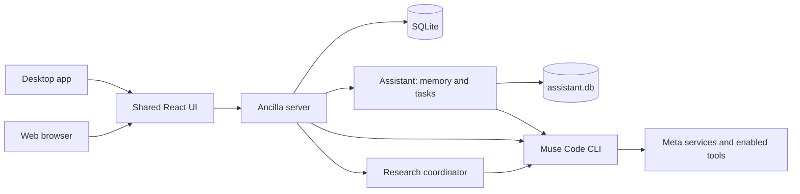

### Repository map

| Path | Responsibility |
| --- | --- |
| [`packages/ui`](packages/ui) | React components and state models; Crew projections live in `src/model/crew.ts`. |
| [`packages/daemon`](packages/daemon) | Muse sessions, runtime discovery and SQLite storage. |
| [`packages/daemon/src/research`](packages/daemon/src/research) | Research supervision, budgets, prompts and citation processing. |
| [`packages/server`](packages/server) | HTTP/SSE API, accounts, project files and research job coordination. |
| [`packages/server/src/research`](packages/server/src/research) | Muse research adapters, job lifecycle and PDF/DOCX/HTML export. |
| [`packages/server/src/assistant`](packages/server/src/assistant) | The assistant's memory, task executive, schedules and the measurements in `eval/`. |
| [`apps/web`](apps/web) | Browser entry point, API client, theme tokens and demo fixtures. |
| [`apps/desktop`](apps/desktop) | Tauri shell, bundled server and desktop updater. |

Start with [Product](docs/PRODUCT.md), [Design](docs/DESIGN.md), [agent monitoring](docs/agent-activity.md),
[the assistant](docs/assistant.md) or [Muse recovery](docs/muse-recovery.md). Release maintenance is documented in [Releasing](docs/RELEASING.md).

## Data and connections

Ancilla keeps project metadata and activity history in its server's local SQLite database, with research reports in
the project folder. The assistant, once switched on, keeps its notes, tasks and character (name, face and voice) in a
second file, `assistant.db`, in the same folder; it is not created before that and is not encrypted at rest. Muse maintains its own sessions and login. There is no Ancilla-hosted account service, telemetry
or analytics in the app. **Running Muse can send prompts, code and other context to Meta's services and enabled
tools**; local storage does not mean model execution stays on your machine.

The desktop app makes an automatic **update check** soon after launch and every six hours, fetching `latest.json` from this repository's
[GitHub Releases](https://github.com/aleff-ferreira/ancilla/releases). A newer version's installer is downloaded from
the same release, and its signature is verified before it installs. **Pause updates** in Settings stops the automatic
checks. The web app has no updater.

Other connections follow from the work you request or the content you open:

- **Muse Code itself** talks to Meta's services under your login; that is what running an agent means. Features that
  call `muse` for you include Deep Research, generated thread titles (a `muse exec` call, with a switch in Settings)
  and in-app `muse login`. Ancilla does not require a separate provider credential for research.
- **Images in Markdown** that point at a web address, in Muse's replies or in a Markdown file you preview, load from
  that address, the same way a browser shows them. The interface does not block or proxy them.
- **Adding a project from a Git URL** runs `git clone` on your machine.
- **The web app** connects to the server address you give it on `#/connect`.
- **Links in replies** open in your default browser.
- **Building from source** downloads npm packages, and the desktop build downloads Node.js from `nodejs.org`.

## Legal

- **Official protocol delegation:** Ancilla connects to Meta Muse via Meta's MIT-licensed MSP SDK, to OpenAI Codex via `codex app-server`, to Anthropic Claude Code via documented `--input-format stream-json` / `--permission-prompt-tool stdio`, and to Gemini, GitHub Copilot, Kimi, Qwen, OpenCode, and custom agents via the open Agent Client Protocol (ACP) over `stdio`. Direct HTTP requests are used strictly for user-supplied API keys (OpenRouter, Venice, OpenAI, Anthropic, Google) and local inference servers (Ollama, LM Studio, llama.cpp, vLLM).
- **Zero credential scraping:** Ancilla never reads, extracts, decrypts, or forwards third-party OAuth tokens from CLI credential files (`~/.claude/.credentials.json`, `~/.codex/auth.json`, `~/.gemini/oauth_creds.json`, `hosts.json`) or OS keychains, and never impersonates vendor OAuth client IDs.
- **Name and trademarks:** `Ancilla` avoids vendor marks in its binary name, bundle ID, domain, and window title. Third-party product names appear solely for nominative identification of user-selected backends.
- **AGPLv3 §13 remote source offer:** When `ancilla-server` binds to a non-loopback network interface (such as `--host 0.0.0.0`), `/api/providers` and **Settings → About** surface a direct link to the Complete Corresponding Source Code under GNU AGPL v3.
- Ancilla never claims to be official, never bundles proprietary CLIs or credentials, and never bypasses billing or approvals.
- Contributor-tier models: prompts and completions sent to them may be used to improve Meta's products. The model
  picker marks those models and says so.
- See also: [Meta Brand Resources](https://www.meta.com/brand/resources/meta/our-trademarks),
  [Muse Code product page](https://developer.meta.com/ai/products/muse-code),
  [Model API docs](https://dev.meta.ai/docs/coding-agents).

This section is not legal advice.

## Contributing

See [CONTRIBUTING.md](CONTRIBUTING.md); pull requests are welcome. Report vulnerabilities as described in
[SECURITY.md](SECURITY.md), not in a public issue.

## License

[GNU AGPL v3](LICENSE). Copyright (c) 2026 Aleff Ferreira Francisco. Anyone who changes Ancilla and runs it for others,
or ships it, must offer their version's source under the same license.

Portions of Ancilla derive from Helicon, Copyright (c) 2026 Harjot Singh Rana and contributors, under the MIT License; its notice is kept in [LICENSE-HELICON](LICENSE-HELICON).
The research engine selectively ports Deep Dog 2 by Benjamin Andrew Eadie, building on ThinkDepth Deep Research by
Paichun Lin; see [NOTICE.md](NOTICE.md) and the [upstream map and MIT notices](packages/daemon/src/research/UPSTREAM.md).
Bundled third-party software is listed with its licenses in [THIRD_PARTY_NOTICES.md](THIRD_PARTY_NOTICES.md).
