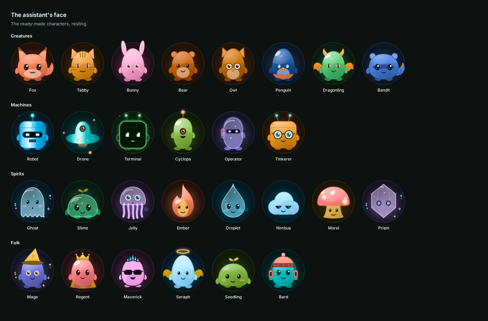

# The assistant's look: choosing, building, drawing and bringing a face

The assistant's face began as five forms of light with four variants each. That was too little to make it yours, and
there was no way to bring your own. The Look section of the Persona tab now has five tabs, and this page says how they
work, why they are built the way they are, what the formats are, and what was and was not checked.



The user-facing description is in [the assistant as a character](assistant.md#the-assistant-as-a-character). Desktop
pets that sit beside a coding agent were the inspiration: a small character that shows whether the agent is working,
waiting for you or done, that you can pick from a set or make yourself, and that can come from a sprite sheet. What is
different here is that every look, whatever it is made of, answers to the same six moods, and that nothing needs an
image model: the built-in art is drawn from parts, and yours comes from a studio, a picture or a file.

## What it wears

| Kind | What it is | Where it lives |
| --- | --- | --- |
| **Sigil** | One of five forms of light (Halo, Optic, Hologram, Critter, Cipher), with a variant, a hue and a glow | In the profile (`form`, `detail`, `hue`, `glow`, `seed`) |
| **Figure** | A character built from parts: ten small values | In the profile, as `look: { kind: "figure", figure }` |
| **Pixel art** | A drawing of 8 to 64 cells a side with frames per mood | On the server, as a saved avatar; the profile holds `look: { kind: "pack", id, rev }` |
| **Picture** | One picture, or a sprite sheet with a row per mood | The same |

An avatar the user made or brought is a **pack**: a row in `avatar_packs` in `assistant.db` (schema version 6), with a
name, a kind, its data as JSON and its size. The library on the Persona tab (Mine) lists them.

### Why the profile stays small

The profile rides along with everything the page reads: the status call, every change the server announces, the sidebar
card, the call dock. A figure is about 150 bytes and costs nothing to carry. A picture is up to half a megabyte, so it
would be sent with every one of those. The profile therefore names a pack by id and revision, and the interface fetches
the pack once and holds it (`PackStore`), asking again only when the revision moves. While a pack loads, or if it was
deleted somewhere else, the face falls back to the plain form of light, so something always shows.

### Why the server checks the shape of a part id and not whether it exists

The catalogue of parts lives in the interface (`companion/figure/parts.ts`). The server checks that each part is a short
lower-case id and that the numbers are whole and inside their range, and nothing more. A figure saved by a newer Ancilla
with a part this one has never heard of is kept, and drawn with the plain part of that slot by the older one. A rule that
refused unknown ids would make downgrading, or opening an exported file on another machine, fail for a cosmetic reason.

## The six moods

Every look reacts to the same six moods, which are the plain facts of the moment (resting, working, wanting you, pleased,
concerned, asleep). What differs is how.

- A **sigil** moves as it always has.
- A **figure** switches its eyes (open, narrowed to work, wide to ask, a glad arc, a worried brow, closed), its mouth,
  its body (a breath at rest, a hop when it wants you, a bounce when it is pleased, a shiver when it is concerned, a slow
  breath asleep), and shows the small signs that all looks share: a "!" when it wants you, thought dots while it works, z's
  asleep, a drop when it is concerned. Its eyes follow the pointer where the face is asked to look. What it wears and
  what is around it keep moving (ears twitch, a tail wags, wings flap, a cape flutters, embers rise).
- **Pixel art and pictures** play a mood's own frames when the user gave it some, and otherwise wear the resting frames
  and move in the mood's own way: a bob while it works, a hop when it wants you, a bounce when it is pleased, a shiver when
  it is concerned, a slow breath asleep. A mood that has frames of its own is not also bounced about.

Reduced motion holds every look still, lit. Frame cycling stops while the page is hidden. A face on a card in a gallery is
paused until the card is pointed at, so a page of thirty does not move at once.

## Formats

### Figure

`body`, `top`, `eyes`, `mouth`, `mark`, `gear`, `aura` and `finish` are part ids; `accent` is a hue from 0 to 359 or
`null` for the one that suits the main hue (150 degrees round); `shade` runs from 0 (pastel) to 4 (deep). The main hue and
the glow are the avatar's own, so one slider recolours any figure. The catalogue has fourteen bodies, sixteen things to
grow or wear on top (ears, horns, antennae, a halo, a crown, a beanie, a wizard hat and more), ten kinds of eyes, nine
mouths, nine markings, ten pieces of gear, nine auras and seven finishes: glossy, matte, plush (a stitched seam), glass,
metal, neon and ink. Twenty-eight ready-made characters (`figure/presets.ts`) are figures with a hue and a glow.

### Pixel art

```json
{ "w": 16, "h": 16, "palette": ["#1b1f2a", "#f6d2b5"],
  "moods": { "idle": { "ms": 400, "frames": ["<base64 of w*h bytes>"] } } }
```

A cell is a byte: 0 is clear, and n is `palette[n - 1]`. A frame is the cells in row order as base64. There are at most 32
colours, 8 frames a mood and 32 frames in all, and `idle` is required. The data is uncompressed on purpose: it is small
(a 32 by 32 frame is under 1.4 KB), and a format that can be checked cell by cell cannot hide anything. It is drawn as one
SVG path per colour (runs of cells merged), so it stays sharp at any size and is the same in a test as on screen.

### Picture and sprite sheet

```json
{ "src": "data:image/webp;base64,...", "w": 1024, "h": 1152, "crisp": false,
  "sheet": { "cols": 8, "rows": 9, "moods": { "idle": { "row": 0, "frames": 4, "ms": 220 } } } }
```

`sheet` is absent for a single picture. A row plays `frames` cells from the left, `ms` each, for its mood.

### The file

An avatar leaves as `{ "format": "ancilla.avatar", "version": 1, "name", "kind", "data" }` in a `.ancilla-avatar.json`
file, and comes back through Mine, Import an avatar file. Nothing is fetched from a link and nothing is executed: the
file is read as JSON, and the server checks the data as it would anything else.

### Limits

| | |
| --- | --- |
| Avatars kept | 24 |
| One avatar's data | 700 KB as JSON (a picture of about 520 KB) |
| All avatars | 8 MB |
| A name | 40 characters, and not a credential |

## What the server refuses

A saved avatar is checked field by field before it is stored (`packages/server/src/assistant/avatars.ts`). Unknown keys
are refused. Pixel frames are decoded and must be canonical base64 of exactly `w * h` cells, none pointing past the
palette. A picture must be a data URL of a PNG, WebP or JPEG (never an SVG, which can carry script), its bytes must start
with the signature of the type it claims, and a PNG's header must give the size it says. Every number is a whole number
inside its range, and a sheet's rows must exist. A refusal names the field and the reason, and a stale save is refused the
way a stale profile is.

## Bringing a picture in

The picture is read in the page and never leaves the computer. A single picture is shrunk until its long side is at most
320 pixels; a sheet is cut into cells and each is shrunk to at most 192, drawn cell by cell so that no frame bleeds into
the next, and the whole is held to 1.2 million pixels. It is written as WebP where the browser can and PNG where it cannot,
and shrunk again until it fits in about 440 KB. Which cells of a sheet have anything in them is read from the pixels, so
the frame count of each row is found, not typed.

A sheet with the cell size desktop pets share (192 by 208) is opened as a sheet. For any other picture the grid is a guess
(from common cell sizes) that is offered, not applied. The rows are matched to moods by you, in order by default. A button
lays them out the way desktop-pet sheets seem to: resting, then a run, then a wave, a jump and a stumble. That layout is
a guess, because the exact order of those sheets was not available to check; each row can be changed, and the preview
shows what it does at once. An animated GIF is used as its first frame.

## Where it is, and how to add a part

- `companion/figure/` (`parts.ts` the catalogue and helpers, `bodies.tsx` the silhouettes and their anchors, `face.tsx`,
  `tops.tsx`, `gear.tsx`, `aura.tsx`, `Figure.tsx` the composition, `presets.ts`).
- `companion/pixel/` (the studio, the pure pixel library, the sprite) and `companion/looks/` (the five tabs, the
  library, the importer).
- `companion/Avatar.tsx` chooses what to draw; `companion/packs.tsx` is the cache; `companion/look.ts` turns a look into
  something drawable and into words.
- The styles are `.fg-*` and `.av-motion` in `apps/web/src/theme.css`, driven by `--h` (hue), `--fa` (accent),
  `data-shade`, `data-finish` and `data-mood` on the root. A CSS transform replaces an SVG transform attribute, so motion
  goes only on groups that have none.

To add a part: add its id and name to the catalogue, draw it from the body's anchors, style it, and run the tests. The
tests draw every part of every slot on every body, in every mood, and fail on a broken coordinate, a repeated id or a part
missing from the catalogue.

## Checked, and not

- Unit tests cover the catalogue, every part on every body and mood, the presets, look resolution, the pack cache, the
  pixel library, the sheet arithmetic, the avatar file, the Look editor, and the server's validation, storage, limits,
  migration and routes.
- The flows were run in headless Chromium against the browser demo: choosing, building, saving and wearing a figure, drawing
  and saving pixel art, importing an 8 by 9 sheet and wearing it, in each mood. That found a real bug (the studio's canvas
  stayed blank in a development build, because a cancelled animation frame left a stale id), which is fixed.
- Not checked: the desktop app's WebView on macOS and Windows (WebP encoding falls back to PNG where the browser cannot
  write WebP), painting by touch or pen, and screen readers other than by reading the markup.

## Not done

- Animated GIF or APNG import (a frame at a time needs a decoder the browsers do not all have).
- A different picture for each mood in one go (a sheet does it).
- Sharing by a link, or a gallery of other people's avatars.
- A figure's eyes follow the pointer, but pixel art and pictures do not.
