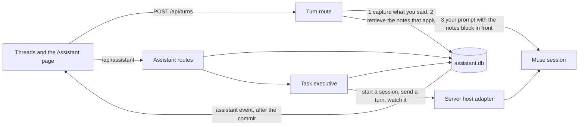

# The assistant

Ancilla's assistant is a memory and a task executive that sit beside Muse. The memory keeps what you told it, with the
exact words, so a thread no longer starts from nothing. The executive takes work you approve and sees it through, one
step at a time, in a thread you can open. It adds no model of its own and no second runtime: Muse still does all the
thinking, on your plan.

It is **off until you switch it on**, and until you do there is no file on disk and no code of it running.

Related: [what it is measured against](assistant-baseline.md), [how well it does](assistant-evaluation.md).

## Switching it on

Open the Assistant page from the sidebar footer and turn it on. That creates `assistant.db` in Ancilla's data folder
(next to `ancilla.db`) and nothing else. From then on:

- what you type in a thread is read for things worth keeping (rules, preferences, decisions, deadlines, facts about you);
- the notes that bear on each message are put in front of the prompt as a short block of reference data, and the thread
  keeps showing the words you typed;
- you can open any note, see the exact words it came from, correct it, pin it, or erase it.

**What it costs.** Capture and retrieval are local rules and SQLite: no model call, no network. A turn carries at most
the assistant's context budget (900 estimated tokens by default, 300 to 4,000), and nothing at all when no note applies
and you have not set an identity or goals. The Assistant page can show the exact block for any question before you send it.

**What it will not keep.** Passwords, API keys, tokens, card numbers, bank accounts and national ID numbers are refused,
and the refusal says why without repeating them.

## The Assistant page

Open it from the sidebar footer (the brain icon) or at `#/assistant`. The switch at the top turns the assistant on and
off. Off, the page says what it is and what it keeps, and a notice says how many saved notes are waiting unused. On, it
has three tabs.

- **Memory.**
  - *What it keeps*: pause or resume remembering, add a note yourself, export everything as a file, tidy up (merge
    duplicates, let passing notes expire, write the monthly roll-ups), or erase everything.
  - *Notes*: Current (what it believes now), Needs you (disputes and notes waiting for your approval) and History
    (beliefs that were replaced, shown with what replaced them), with a kind filter and a search. Each row says who said
    it, how long ago, and flags such as Disputed, Unconfirmed guess, May be out of date and In every prompt. Opening a
    row shows the exact words, the sources, the earlier versions and what it replaced, and lets you correct it, pin it,
    confirm it ("Still true"), settle a dispute ("This one is right"), approve a waiting note, or forget it.
  - *What the model is told*: type a question and see the block that would go in front of it and why each note is in
    it, without sending anything.
  - *What changed*: the audit log of every change and who made it.
- **Tasks.** Give it a task (a goal, a project, whether it may change files, and steps that each end in a check), see
  what it would do next (or what is waiting on you, when initiative is Ask first), and watch open tasks with Pause,
  Resume, Cancel, Try again, Give it more room and "It is right". Finished tasks say whether the result was checked.
  Repeating work lives here too, each with its time zone and an end.
- **Settings.** Name and character, tone, length and language, goals, initiative (Ask first, Suggest, Act within
  limits), whether it may start read-only work on its own, whether a task may be given write access, the limits on how
  much it may spend, and how large the notes block may be.

The page reads again on its own when the server announces a change. In any page, a save, a replacement, a refusal (a
credential, or remembering paused) and a question about which of two notes you meant show as a short message.

## How the memory works

### What a memory is

| Field | Meaning |
| --- | --- |
| kind | fact, preference, constraint (a standing rule), event, decision, procedure, commitment (something owed, with a due time), or working (this conversation only, expires) |
| scope | global, account, project or thread. A project's notes are never candidates for another project |
| basis | `explicit` (you said it), `observed` (a check confirmed it), `inferred` (a guess). A guess never replaces what you said and repeating it does not promote it |
| trust | where the words came from: you, a verified check, an unverified source, an untrusted source (a web page, a tool, a file). Untrusted words wait for your approval and never change what is believed |
| time | when it was said (never when it was processed), when it was last confirmed, a validity window, a due time |
| source | the exact words, the thread and message they came from |
| revisions | every change to the words, with who made it and why |

### Belief change

A new statement about the same thing is a new memory, and the old one becomes history, linked to what replaced it. That
is true whether the new statement is a slot's new value ("my timezone is..."), a restatement, or an explicit correction
("actually, ... instead of ..."). Rules:

- A statement already on file is corroborated (a second source is added), never duplicated.
- A correction replaces the memory it is about, found by its words and identifiers. If it could be about several, the
  correction is kept waiting and you choose; the choice survives a restart.
- A late job never overwrites a newer statement. An older statement that arrives after a newer one is kept as history.
- Equal statements that disagree (same moment, same standing) are both marked disputed until you settle it.
- A forgotten memory is erased with its earlier versions: the words are removed from the revisions, the sources, the
  text index, any summary derived from it, and the free pages of the file (`secure_delete`, an index rewrite and a log
  checkpoint). What is kept is a salted fingerprint. The same words read again from before the erasure (a replayed
  message, an import) are refused; you saying them again afterwards is accepted, because that is your choice.
- Pausing capture stops new memories only. Words said while capture was paused are not read when it comes back.

### Retrieval

For each message: filter by account, project, thread and time first (scope is a filter, not a score); take the standing
rules, what you pinned, what is due and this thread's working notes; add notes found by full-text search (SQLite FTS5,
BM25, stemming) and by exact identifier; score by match, kind, scope, age, confidence and standing; drop what repeats;
fit what is left in the budget, rules first. The block marks guesses and disputes, flags anything about something that
changes and has not been confirmed lately, shows the exact words when asked "why do you think...", and says "nothing is
saved" when a question about what is remembered finds nothing, instead of leaving a gap to fill. Words from a note are
neutralised so a note cannot close its own block.

Retrieval is lexical on purpose. The evaluation measures how much that costs on paraphrase and what each added
technique buys; see [assistant-evaluation.md](assistant-evaluation.md).

### What memory is not allowed to do

Memory never grants authority. The assistant's permissions come from its settings (autonomy, read-only, project writes,
commands, budgets) and from Muse's approvals, neither of which reads memory. A note that says "always approve writes" is
data.

## How tasks work

A task is a goal, one or more steps, a project, and limits. Each step runs as a turn in a thread of its own that you can
open; its approvals reach you like any other thread's. The task adds the notes that bear on the goal in front of each
step, built when the step starts, so a correction you make between steps is in the next one.

| State | Meaning |
| --- | --- |
| queued | waiting for a free slot or the daily limit; the reason is shown |
| running | a turn is in progress |
| waiting | Muse could not be reached, or a step could not be started; retried with a growing delay, and the reason is shown |
| paused | you paused it, you spoke in its thread, or the turn was interrupted from outside. Nothing new starts |
| blocked | it needs you: a check failed, a budget ran out, or a step may or may not have run |
| completed | every check the task has passed, and the evidence is shown |
| unverified | it finished without an error and nothing could check the result. You can confirm it |
| failed, cancelled | as they say |

**Evidence.** A step may carry a check: a file exists, a file contains some text, or you confirm. The executive reads the
project's own files to run it. A task is "completed" only when it has checks and they all passed; otherwise it ends as
"unverified" and says so.

**Limits.** Per task: turns and minutes (never more than the settings allow, extendable up to twice). Overall: how many
tasks run at once and start per day. Time spent waiting for your approval is not charged. A limit that is reached stops
the task with the reason and the way to raise it.

**Correlation.** Every attempt has a fence number and a command id. A turn's end is matched to its attempt by thread and
turn; one that is not the current attempt's (a cancelled task's turn, an old attempt's) is refused and recorded.

**Restarts.** The executive runs while Ancilla is open. When it starts again it settles what was in the air: a turn the
ledger knows finished is recorded and checked; one the ledger does not know is not run again on a guess if the step can
change anything: the task stops and asks. A step that only reads is run again with a new fence.

**Cancelling and pausing.** Cancelling interrupts the running turn (and says if it could not confirm that), and anything
the turn reports afterwards is refused. Pausing lets the running turn finish, records its result, and starts nothing new.

**Initiative.** The assistant can propose what to do next: a commitment that is due, a note about something that changes
and needs confirming, a goal nothing is working toward, a task that is waiting on you. What it does about them is the
autonomy setting: under "ask" it only says what is waiting on you, under "suggest" it lists the work, under "act" it
starts the work that only reads and rests on something you said in a project, at most two a day, once each. Anything that
would change a file is offered, never started.

**Schedules.** A recurring task needs its time zone, and an end date or a number of runs (at most a year, at most every
15 minutes). A missed run is skipped by default; a run is skipped when the last one is still going.

## How it fits into Ancilla

- **`packages/daemon` is untouched.** It still speaks to Muse and owns `ancilla.db`.
- **`packages/server` owns the assistant.** It is the only code that opens `assistant.db`. It reaches the rest of the
  server at three points: the turn route (capture, then retrieve, then prepend; a failure there never stops the turn, and
  slash commands are left alone), the session machinery a task uses (the same `startSession` and `sendTurn` a person
  uses, so a task is an ordinary thread with the same approvals) and the event stream. The data folder's lock, the host
  and origin checks and the token cover its routes like the rest.
- **`packages/ui` holds no assistant logic.** One generic client call, a page of views and a toast for the stream's
  events. The browser demo answers the same routes from fixtures.
- **Muse is the only model.** The assistant makes no call of its own, so there is no second runtime to install and no
  second subscription.

## Where things live

- `assistant.db` (and `-wal`, `-shm`) in the data folder. Own migrations (`PRAGMA user_version`, each step with an `up`
  and a `down`), write-ahead log, full synchronous commit, `secure_delete` on. Tables: profile and goals; memory items,
  revisions, sources, evidence links, links between items, tombstones, a capture log, summaries and an audit log of what
  changed and who changed it (ids and rule names, never the words); tasks, steps, attempts, events, checkpoints and
  schedules; and an FTS5 index that is rebuilt from the items whenever it disagrees with them.
- Code: `packages/server/src/assistant/`. The pure parts (extraction, resolution, ranking, context) have no database,
  clock or Muse in them.

## HTTP

All under `/api/assistant`, behind the same host check, origin check and token as the rest of the API.

| Route | Does |
| --- | --- |
| `GET /` | status: profile, goals, counts, open tasks |
| `PATCH /profile` | change identity, style, autonomy, limits, pause capture; refuses a stale view |
| `GET /memories`, `POST /memories` | list (status, kind, scope, search) and add |
| `GET /memories/:id`, `PATCH`, `DELETE` | read with sources, revisions and lineage; edit (refused if stale); erase |
| `POST /memories/:id/{pin,unpin,confirm,settle,approve,commitment}` | the rest of what you can do to one |
| `POST /wipe` | erase everything, only with `{"confirm":"wipe everything"}` |
| `GET /export` | everything you may keep, as a file |
| `POST /preview`, `GET /threads/:id/context` | what the model would be told, and what the last turn used |
| `GET /activity` | what changed and who changed it |
| `GET/POST /goals`, `PATCH/DELETE /goals/:id` | goals |
| `GET/POST /tasks`, `GET /tasks/:id`, `POST /tasks/:id/{pause,resume,cancel,retry,confirm,extend,resolve}` | tasks |
| `GET /suggestions`, `POST /suggestions/{accept,dismiss}` | what to do next |
| `GET/POST /schedules`, `POST /schedules/:id/{enable,disable}`, `DELETE` | schedules |

Events arrive on the existing stream as `{ "type": "assistant", "reason": "memory" | "profile" | "goal" | "task", ... }`,
and a save is announced only after it is committed.

## Rolling back

Nothing outside `assistant.db` depends on the assistant, so every step below is local.

1. **Switch it off** (Assistant page, or `PATCH /api/assistant/profile {"enabled": false}`): capture and injection stop,
   running tasks are paused, nothing is deleted.
2. **Keep a copy first**: the Export button, or `GET /api/assistant/export`. An export holds items with revisions and
   sources, goals and the profile. It does not hold erased memories or their fingerprints.
3. **Remove it**: quit Ancilla and delete `assistant.db`, `assistant.db-wal` and `assistant.db-shm`. Ancilla starts as if
   it had never been switched on.
4. **Downgrade Ancilla**: an older Ancilla does not open `assistant.db`, so it ignores it. A newer file than the program
   understands is refused, never altered, with a message saying which version to restore.
5. **Step the schema back** without removing the file: `scripts/assistant-rollback.mjs <data folder> <version>` writes an
   export first, then runs the steps' `down` scripts (version 1 is memory and profile; version 2 adds tasks).

## What it does not do

- Extraction is rule based. It reads plain statements well ("remember that...", "I prefer...", "actually, ..."), and a
  statement phrased in an unusual way is not captured. Nothing is captured from the assistant's or a tool's words.
- A sentence you paste into a message is read as yours unless it is fenced, quoted or tagged as a document. The page
  shows every capture with its source, so nothing is hidden, and memory cannot grant permissions, but this is a real
  limit.
- Retrieval finds notes by words and identifiers. A question that shares no word with the note it needs will not find it.
- Tasks run only while Ancilla is open (the desktop shell closes the server with its window), and they need Muse. Checks
  read files in the project; they do not run commands.
- `assistant.db` is not encrypted at rest, like `ancilla.db`, and the desktop server runs without a token on loopback, so
  a local process that can reach the port can read it as it can read threads.
- One assistant per data folder. Notes can be scoped to an account, but there is no separate assistant per account.
